# Layer diagram (package architecture)

React web client + Spring Boot REST API organized into **presentation, business
logic, data and entities** —the four layers required by the rubric (RAP2)—, with
cross-cutting components. GitHub renders this diagram directly from the Mermaid code.

> Detailed-design version, with the same packages on one sheet:
> [`diagrama_capas.png`](diagrama_capas.png) (also [SVG](diagrama_capas.svg); editable
> in [`diagrama_capas.drawio`](diagrama_capas.drawio)), regenerated in English when
> Stage 1 closed. When a package changes, update this Mermaid code and the `.drawio`
> together.

```mermaid
flowchart TB
  subgraph FE["PRESENTATION — web client · frontend (React 19 + TypeScript · Vite · Tailwind CSS v4 + shadcn/ui)"]
    direction LR
    pages["<b>pages</b><br/>views per role; never call axios directly"]
    components["<b>components</b><br/>ui (shadcn/ui), layout with<br/>the menu of each role, forms"]
    routes["<b>routes</b><br/>AppRouter · RequireRole<br/>routes protected by role"]
    auth["<b>auth</b><br/>AuthProvider: session and user,<br/>access token in memory"]
    api["<b>services / api</b><br/>httpClient (axios): Bearer JWT,<br/>refresh with the sierap_refresh cookie"]
    types["<b>types</b><br/>mirror the backend DTOs"]
  end

  subgraph BE["co.edu.unicesar.sierap — backend (Java 21 · Spring Boot 3.5)"]
    direction TB
    subgraph P["PRESENTATION — REST API"]
      direction LR
      controller["<b>controller</b><br/>@RestController<br/>AuthController, AccountController,<br/>MomentController, GroupController …"]
      dto["<b>dto</b><br/>request / response as records<br/>validation with @Valid · ErrorResponse"]
      mapper["<b>mapper</b><br/>UserMapper, MomentMapper, GroupMapper …<br/>entity → DTO"]
    end
    subgraph L["BUSINESS LOGIC"]
      direction LR
      service["<b>service</b><br/>«interface» AuthService, AccountService,<br/>MomentService, GroupService, EmailService …"]
      impl["<b>service.impl</b><br/>@Service · @Transactional<br/>rules: status and windows of the moment,<br/>members per group, per-role scope (AccessScope)"]
    end
    subgraph DA["DATA"]
      repository["<b>repository</b><br/>extends JpaRepository&lt;T, Long&gt;<br/>queries with @Query"]
    end
    subgraph EN["ENTITIES"]
      direction LR
      entity["<b>entity</b><br/>User {abstract} + 5 roles, Faculty, Program,<br/>AcademicPeriod, Moment, LearningOutcome, EvaluationCriterion,<br/>PerformanceLevel, ProjectGroup, Submission, Evaluation …"]
      enums["<b>entity.enums</b><br/>UserRole · DocumentType · MomentStatus<br/>EvaluationStatus · PasswordTokenPurpose"]
    end
    subgraph T["CROSS-CUTTING"]
      direction TB
      security["<b>security</b><br/>SecurityConfig · JwtAuthFilter · JwtService<br/>RefreshCookie · @PreAuthorize per role"]
      exception["<b>exception</b><br/>GlobalExceptionHandler «@RestControllerAdvice»<br/>SierapException and subclasses"]
      config["<b>config</b><br/>ClockConfig · AuthProperties<br/>application-dev / prod"]
    end
  end

  subgraph INFRA["INFRASTRUCTURE"]
    direction LR
    db[("<b>PostgreSQL 17</b><br/>Flyway migrations")]
    files[("<b>File storage</b> · Stage 5<br/>server disk (ADR-015)<br/>.zip · .pdf · .docx · .pptx")]
    smtp[("<b>SMTP server</b><br/>account and password emails<br/>Mailpit in dev")]
  end

  api -- "HTTP / JSON · Bearer JWT · refresh cookie" --> controller
  controller -. «use» .-> dto
  mapper -. «use» .-> dto
  controller -. «use» .-> service
  impl -. implements .-> service
  impl -. «use» .-> repository
  repository -. «use» .-> entity
  security -- filters every request --> controller
  exception -. handles errors .-> controller
  repository -- Spring Data JPA · JDBC --> db
  impl -- stores / reads files --> files
  impl -- sends emails --> smtp

  classDef pres fill:#DBEAFE,stroke:#3B6FB6,color:#1F2937
  classDef log fill:#EDE4FB,stroke:#7E57C2,color:#1F2937
  classDef dat fill:#FEF3C7,stroke:#B7791F,color:#1F2937
  classDef ent fill:#DCFCE7,stroke:#2F855A,color:#1F2937
  classDef tr fill:#F1F5F9,stroke:#64748B,color:#1F2937
  classDef inf fill:#E0F2FE,stroke:#0369A1,color:#1F2937
  class pages,components,routes,auth,api,types,controller,dto,mapper pres
  class service,impl log
  class repository dat
  class entity,enums ent
  class security,exception,config tr
  class db,files,smtp inf
```

## Architecture rules

| Rule | Why |
|---|---|
| Each layer only uses the one right below it (`controller → service → repository → entity`). | It is the full layered architecture the rubric assesses (RAP2). |
| JPA entities never leave the API: the controller always responds with DTOs. | Avoids exposing `passwordHash` or internal relationships and decouples the API from the model. |
| No business logic in the controllers. | The rules (members per group, dates within the UPC range, per-role scope) live in `service.impl` and are tested with JUnit + Mockito. |
| No scattered `try/catch`: errors are thrown as `SierapException` and translated by `exception`. | Uniform error responses and centralized exception handling (rubric RAP2). |
| No hard-coded business values. | RAP, weights and semester ranges are read from the database (`GlobalParameter`, `Moment`, `LearningOutcome`). |
| Code in English; screens, error messages, Javadoc and comments in Spanish. | Team convention (ADR-014). |

## Mapping to the rubric

| Layer required by the UPC guide | Package in SIERAP |
|---|---|
| Presentation | `frontend` (React) + `controller`, `dto`, `mapper` |
| Logic | `service`, `service.impl` |
| Data | `repository` + PostgreSQL |
| Entities | `entity`, `entity.enums` |
