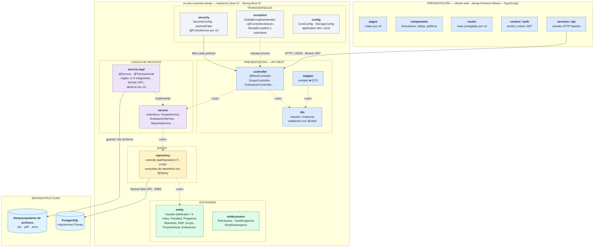

# Diagrama de capas (arquitectura por paquetes)

Cliente web React + API REST en Spring Boot organizada en **presentación, lógica de
negocio, datos y entidades** —las cuatro capas que pide la rúbrica (RAP2)—, con
componentes transversales. GitHub renderiza este diagrama directamente a partir del
código Mermaid.

> Versión con diseño detallado: [`diagrama_capas.png`](diagrama_capas.png) · editable en
> [`diagrama_capas.drawio`](diagrama_capas.drawio).

## Reglas de la arquitectura

| Regla | Por qué |
|---|---|
| Cada capa solo usa la inmediatamente inferior (`controller → service → repository → entity`). | Es la arquitectura por capas completa que evalúa la rúbrica (RAP2). |
| Las entidades JPA nunca salen de la API: el controller responde siempre con DTOs. | Evita exponer `passwordHash` o relaciones internas y desacopla la API del modelo. |
| Sin lógica de negocio en los controllers. | Las reglas (3–5 integrantes, fechas dentro del rango UPC, alcance por rol) viven en `service.impl` y se prueban con JUnit + Mockito. |
| Sin `try/catch` disperso: los errores se lanzan como `SierapException` y los traduce `exception`. | Respuestas de error uniformes y manejo de excepciones centralizado (rúbrica RAP2). |
| Nada de valores de negocio hardcodeados. | RAP, pesos y rangos de semestre se leen de la base de datos (`ParametroGlobal`, `Momento`, `RAP`). |

## Correspondencia con la rúbrica

| Capa que pide la guía UPC | Paquete en SIERAP |
|---|---|
| Presentación | `frontend` (React) + `controller`, `dto`, `mapper` |
| Lógica | `service`, `service.impl` |
| Datos | `repository` + PostgreSQL |
| Entidades | `entity`, `entity.enums` |
