# Class diagram (current · Stage 1)

SIERAP domain model with inheritance, abstract classes, interfaces, enumerations and
composition, aggregation, association and dependency relationships. GitHub renders
this diagram directly from the Mermaid code.

> **This is the current diagram** and the Stage 1 contract: it includes the
> 2026-09-24 decisions (see `docs/04`, "Team decisions" section, and ADR-009 to
> ADR-014). Class and attribute names are in English (ADR-014); the Spanish → English
> name table is in [`../03-entidades-dominio.md`](../03-entidades-dominio.md). The
> detailed-design version, with the same model on one sheet, is
> [`diagrama_clases_mejorado.png`](diagrama_clases_mejorado.png) (also
> [SVG](diagrama_clases_mejorado.svg); editable in
> [`diagrama_clases_mejorado.drawio`](diagrama_clases_mejorado.drawio)), regenerated when
> Stage 1 closed. When the model changes, update this Mermaid code and the `.drawio`
> together. The Phase 1 preliminary diagram is still in
> [`diagrama_clases.drawio`](diagrama_clases.drawio).

```mermaid
classDiagram
direction TB

%% ================= Users and roles (D1) =================
class User {
  <<abstract>>
  -id: Long
  -firstNames: String
  -lastNames: String
  -documentType: DocumentType
  -documentNumber: String
  -email: String
  -passwordHash: String
  -mustChangePassword: boolean
  -active: boolean
  -createdBy: User
  -createdAt: LocalDateTime
  +getRole()* UserRole
  +getFullName() String
  +isActive() boolean
  +hasPassword() boolean
  +changePassword(newHash: String) void
}
class Evaluator {
  <<interface>>
  +canEvaluate(group: ProjectGroup)* boolean
}
class UserRole {
  <<enumeration>>
  SUPER_ADMIN
  ADMIN
  TEACHER
  STUDENT
  EXTERNAL_EVALUATOR
}
class DocumentType {
  <<enumeration>>
  CC
  TI
  CE
  PASSPORT
}
class SuperAdmin {
  +getRole() UserRole
}
class Admin {
  -faculty: Faculty
  +getRole() UserRole
}
class Teacher {
  -faculty: Faculty
  +getRole() UserRole
  +canEvaluate(group: ProjectGroup) boolean
}
class Student {
  -studentCode: String
  -currentSemester: int
  -program: Program
  -registrationCode: RegistrationCode
  +getRole() UserRole
}
class ExternalEvaluator {
  -evaluatorType: EvaluatorType
  -organization: String
  -position: String
  -graduationYear: Integer
  -graduationProgram: Program
  +getRole() UserRole
  +canEvaluate(group: ProjectGroup) boolean
}
class EvaluatorType {
  -id: Long
  -name: String
  -description: String
  -active: boolean
}

%% ================= Accounts and sessions (D1, Stage 2 · ADR-017) =================
class RegistrationCode {
  -id: Long
  -code: String
  -teacher: Teacher
  -program: Program
  -expiresOn: LocalDate
  -active: boolean
  -createdAt: LocalDateTime
  +isUsableOn(today: LocalDate) boolean
  +deactivate() void
}
class RefreshToken {
  -id: Long
  -user: User
  -tokenHash: String
  -expiresAt: LocalDateTime
  -rotatedAt: LocalDateTime
  -createdAt: LocalDateTime
  +isActiveAt(now: LocalDateTime) boolean
  +isRotated() boolean
  +markRotated(now: LocalDateTime) void
}
class PasswordToken {
  -id: Long
  -user: User
  -tokenHash: String
  -purpose: PasswordTokenPurpose
  -expiresAt: LocalDateTime
  -usedAt: LocalDateTime
  -createdAt: LocalDateTime
  +isUsableAt(now: LocalDateTime) boolean
  +markUsed(now: LocalDateTime) void
}
class PasswordTokenPurpose {
  <<enumeration>>
  ACCOUNT_SETUP
  PASSWORD_RESET
}

%% ================= Academic structure and configuration (D2) =================
class GlobalParameter {
  -key: String
  -value: String
  -description: String
}
class Faculty {
  -id: Long
  -code: String
  -name: String
  -programs: List~Program~
}
class Program {
  -id: Long
  -code: String
  -name: String
  -faculty: Faculty
  -moments: List~Moment~
}
class AcademicPeriod {
  -id: Long
  -code: String
  -startDate: LocalDate
  -endDate: LocalDate
  -upcEvaluationDeadline: LocalDate
  +contains(date: LocalDate) boolean
}
class Moment {
  -id: Long
  -number: int
  -name: String
  -subject: String
  -semesterFrom: int
  -semesterTo: int
  -requirementLevel: String
  -minMembers: int
  -maxMembers: int
  -status: MomentStatus
  -groupFormationStart: LocalDate
  -groupFormationEnd: LocalDate
  -submissionStart: LocalDate
  -submissionEnd: LocalDate
  -gradingStart: LocalDate
  -gradingEnd: LocalDate
  -program: Program
  -period: AcademicPeriod
  -learningOutcomes: List~LearningOutcome~
  -teacherWeight: BigDecimal
  -evaluatorWeights: List~EvaluatorWeight~
  +launch() void
  +isInGroupFormation(today: LocalDate) boolean
  +isInSubmission(today: LocalDate) boolean
  +isInGrading(today: LocalDate) boolean
  +getMaxScore() BigDecimal
  +getWeightFor(type: EvaluatorType) BigDecimal
  +getTotalWeight() BigDecimal
}
class EvaluatorWeight {
  -id: Long
  -moment: Moment
  -evaluatorType: EvaluatorType
  -weight: BigDecimal
}
class MomentStatus {
  <<enumeration>>
  CONFIGURATION
  LAUNCHED
}
class EvaluationStatus {
  <<enumeration>>
  DRAFT
  SUBMITTED
}
class LearningOutcome {
  -id: Long
  -code: String
  -description: String
  -criteria: List~EvaluationCriterion~
  +getMaxScore() BigDecimal
}
class EvaluationCriterion {
  -id: Long
  -description: String
  -displayOrder: int
  -levels: List~PerformanceLevel~
  +getMaxScore() BigDecimal
}
class PerformanceLevel {
  -id: Long
  -name: String
  -description: String
  -score: BigDecimal
  -displayOrder: int
}

%% ================= Operations (D3) =================
class ProjectGroup {
  -id: Long
  -name: String
  -projectTitle: String
  -moment: Moment
  -teacher: Teacher
  -members: Set~Student~
  -evaluators: Set~ExternalEvaluator~
  -submissionDeadline: LocalDate
  -evaluationDate: LocalDate
  +addMember(s: Student) void
  +isFull() boolean
  +hasMinimumMembers() boolean
  +isEnabledBy(t: Teacher) boolean
  +hasEvaluator(e: ExternalEvaluator) boolean
  +nextSubmissionVersion() int
  +getSubmissionToGrade() Submission
  +getFinalGrade() BigDecimal
}
class Submission {
  -id: Long
  -versionNumber: int
  -zipFilePath: String
  -zipFileName: String
  -zipSize: long
  -presentationPath: String
  -presentationFileName: String
  -presentationSize: Long
  -submittedAt: LocalDateTime
  -late: boolean
  +attachPresentation(file: StoredFile) void
  +hasPresentation() boolean
  +isLate() boolean
}

%% ================= Evaluation and reporting (D3) =================
class Evaluation {
  -id: Long
  -evaluator: User
  -status: EvaluationStatus
  -evaluatedAt: LocalDateTime
  -comment: String
  -grades: List~CriterionGrade~
  -individualGrades: List~IndividualGrade~
  +grade(level: PerformanceLevel) void
  +submit() void
  +isSubmitted() boolean
  +isComplete() boolean
  +getTotalScore() BigDecimal
  +getScoreFor(outcome: LearningOutcome) BigDecimal
  +adjust(s: Student, level: PerformanceLevel) void
  +getTotalScoreFor(s: Student) BigDecimal
  +getScoreFor(outcome: LearningOutcome, s: Student) BigDecimal
}
class CriterionGrade {
  -id: Long
  -criterion: EvaluationCriterion
  -level: PerformanceLevel
  -score: BigDecimal
}
class IndividualGrade {
  -id: Long
  -student: Student
  -criterion: EvaluationCriterion
  -level: PerformanceLevel
  -score: BigDecimal
}
class Report {
  <<abstract>>
  -generatedAt: LocalDateTime
  -period: AcademicPeriod
  +generate()* byte[]
}
class IndividualReport {
  -student: Student
  +generate() byte[]
}
class GroupReport {
  -group: ProjectGroup
  +generate() byte[]
}
class ComparativeReport {
  -periodA: AcademicPeriod
  -periodB: AcademicPeriod
  +generate() byte[]
}

%% ================= Relationships =================
User <|-- SuperAdmin
User <|-- Admin
User <|-- Teacher
User <|-- Student
User <|-- ExternalEvaluator
Evaluator <|.. Teacher
Evaluator <|.. ExternalEvaluator
User ..> UserRole : «use»
User ..> DocumentType : «use»
User "0..1" -- "*" User : created by
User "1" *-- "*" RefreshToken : sessions
User "1" *-- "*" PasswordToken : password links
PasswordToken ..> PasswordTokenPurpose : «use»
RegistrationCode "*" -- "1" Teacher : owned by
RegistrationCode "*" -- "1" Program : registers into
Student "*" -- "0..1" RegistrationCode : registered with

SuperAdmin ..> GlobalParameter : «manages»
SuperAdmin ..> AcademicPeriod : «manages»
SuperAdmin ..> EvaluatorType : «manages»
Admin "*" -- "1" Faculty : administers
Teacher "*" -- "1" Faculty : belongs to
Student "*" -- "1" Program : studies
ExternalEvaluator "*" -- "1" EvaluatorType : is of type
ExternalEvaluator "*" -- "0..1" Program : graduated from

Faculty "1" *-- "1..*" Program
Program "1" *-- "*" Moment
Moment "*" -- "1" AcademicPeriod : configured in
Moment ..> MomentStatus : «use»
Moment "1" *-- "1..*" LearningOutcome
Moment "1" *-- "*" EvaluatorWeight
EvaluatorWeight "*" -- "1" EvaluatorType : weighs
LearningOutcome "1" *-- "1..*" EvaluationCriterion
EvaluationCriterion "1" *-- "1..*" PerformanceLevel

Moment "1" *-- "*" ProjectGroup
Teacher "1" -- "*" ProjectGroup : enables
ProjectGroup "*" o-- "min..max" Student : one group per moment
ProjectGroup "*" -- "*" ExternalEvaluator : assigned
ProjectGroup "1" *-- "0..*" Submission

ProjectGroup "1" *-- "0..*" Evaluation
Evaluation "*" -- "1" Evaluator : made by
Evaluation ..> EvaluationStatus : «use»
Evaluation "1" *-- "1..*" CriterionGrade
CriterionGrade "*" -- "1" EvaluationCriterion : grades
CriterionGrade "*" -- "1" PerformanceLevel : selected level
Evaluation "1" *-- "0..*" IndividualGrade : per-student adjustments
IndividualGrade "*" -- "1" Student : adjusted student
IndividualGrade "*" -- "1" EvaluationCriterion
IndividualGrade "*" -- "1" PerformanceLevel : level for that student

Report <|-- IndividualReport
Report <|-- GroupReport
Report <|-- ComparativeReport
Report ..> Evaluation : «use»
```

## Stage 1 changes (2026-09-24 decisions)

| Change | Reason |
|---|---|
| Every class, attribute and method moves to English (`Facultad` → `Faculty`, `Momento` → `Moment`, `RAP` → `LearningOutcome`, `CriterioEvaluacion` → `EvaluationCriterion`, `NivelDesempeno` → `PerformanceLevel`, `Grupo` → `ProjectGroup`…); the full table is in `docs/03` | Code and documentation in English; screens, error messages and Javadoc in Spanish (ADR-014). |
| `Faculty` gains `code` (unique, required) | Institutional code of the faculty (e.g. `04`), like `Program.code` (e.g. `108`). |
| Scores (`score`, `getMaxScore()`, grades) as `BigDecimal` instead of `double` | Exact sums: Moment 1 must add up to 5.00, not 4.9999… (ADR-013). |
| `User`: `name` → `firstNames` + `lastNames`; new `documentType` and `documentNumber`; `DocumentType` enum | Store the identity document besides the email, which is the login field. |
| `Empresario` and `Egresado` → a single `ExternalEvaluator` subclass with an `EvaluatorType` (catalog) | More evaluator types must be creatable without programming (ADR-011). |
| `Teacher` belongs to a `Faculty` | Only teachers with a classroom project use SIERAP, and they teach in their faculty. |
| `Student` loses `group` and gains `program` | A student has one group per moment with history; the relationship lives on the `ProjectGroup` side. |
| `Moment` belongs to an `AcademicPeriod`; `requirementLevel` becomes free text | The configuration is versioned per period and there are no standard levels (ADR-010). |
| `Moment` gains `status` (`MomentStatus`), min./max. members and three date windows | Moment lifecycle: configuration → launch → submissions → grading (ADR-012). |
| `LearningOutcome` (RAP) belongs to a `Moment` (composition) and loses its evaluative weight | Each moment has its own RAP; the weight comes from the scores of its criteria. |
| New `EvaluatorWeight` and `Moment.teacherWeight` | The final grade is weighted by kind of evaluator with percentages that add up to 100 %, set by the admin in each moment (ADR-018). |
| New `EvaluationCriterion` and `PerformanceLevel` (entity) | Structure of the UPC rubric: each RAP has criteria and each criterion levels with scores, all configurable. |
| Group and classroom project merge into `ProjectGroup`, which belongs to a `Moment` | Each group has a single project; the teacher enables groups within a moment. |
| Per-RAP grade → `CriterionGrade` | The evaluator picks one level per criterion; the performance per RAP is a sum. |
| The `NivelExigencia` and `NivelDesempeno` enums are removed | Nothing standard in the code (ADR-010). |
| No student self-assessment | `Student` does not implement `Evaluator`. |

## Stage 1 close (2026-09-28)

| Change | Reason |
|---|---|
| `RegistrationCode`, `RefreshToken`, `PasswordToken` and `PasswordTokenPurpose` (new); `User` gains `mustChangePassword`, `createdBy`, `hasPassword()` and `changePassword()`; `Student` gains `registrationCode` | Stage 2 entities (ADR-017), already in the code and in `docs/03` but missing here. |
| `Evaluator` declares only `canEvaluate()`; `Teacher` and `ExternalEvaluator` show their own `canEvaluate()` | Same as the code: each class implements its own rule (polymorphism). |
| `Evaluation` shows `isSubmitted()` | It is in the code. |
| The detailed `.drawio` is regenerated from this model | It was still the Phase 2 version, with the Spanish names. |
| The legend of the detailed `.drawio` no longer marks `Moment.launch()` as designed only | It is built, with its validations and the V5 constraints (fixes from the PR #3 review). |

## Changes of the contract of Stages 4 to 6 (2026-09-28 decisions)

| Change | Reason |
|---|---|
| `IndividualGrade` (new), composed by `Evaluation`, with `adjust()`, `getTotalScoreFor()` and an overload of `getScoreFor()` per student | The group is graded once and every member inherits it; an evaluator can change the level of some criteria for one student, so each student has an individual grade besides the group grade (ADR-018). |

## Changes compared with the preliminary diagram (Phase 1)

| Change | Reason |
|---|---|
| `AcademicPeriod` (new) | RF 9 requires validating that the evaluation date falls within the UPC range, and RF 12 compares results across semesters and years: both need the period as an entity. |
| `GlobalParameter` (new) | RF 11: the super_admin defines global parameters without hard-coding them. |
| `Report` becomes abstract with 3 subclasses | Each report type implements its own `generate()`: polymorphism instead of a `switch` by type. Resolves the Phase 1 open item about reporting. |
| Abstract `User.getRole()` | Each role overrides it; login leaves the domain and moves to `AuthService` (service layer). |
| Multiplicity `min..max` on `ProjectGroup`—`Student` | The number of members is configured per moment (Moment 1: 3 to 5). |
