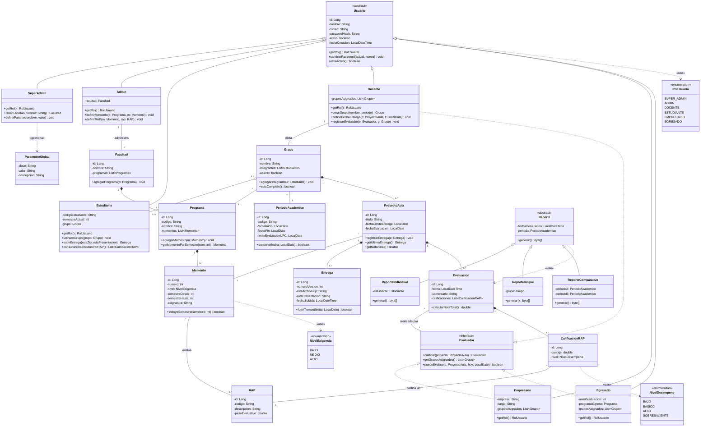

# Diagrama de clases (versión mejorada · Fase 2)

Modelo de dominio de SIERAP con herencia, clases abstractas, interfaces,
enumeraciones y relaciones de composición, agregación, asociación y dependencia.
GitHub renderiza este diagrama directamente a partir del código Mermaid.

> Versión con diseño detallado y colores por área:
> [`diagrama_clases_mejorado.png`](diagrama_clases_mejorado.png) · editable en
> [`diagrama_clases_mejorado.drawio`](diagrama_clases_mejorado.drawio)
> (abrir en [app.diagrams.net](https://app.diagrams.net)). El diagrama preliminar
> de la Fase 1 sigue en [`diagrama_clases.drawio`](diagrama_clases.drawio).

## Cambios frente al diagrama preliminar (Fase 1)

| Cambio | Motivo |
|---|---|
| `PeriodoAcademico` (nueva) | RF 9 exige validar que la fecha de evaluación caiga en el rango de la UPC, y RF 12 compara resultados entre semestres y años: ambos necesitan el periodo como entidad. |
| `ParametroGlobal` (nueva) | RF 11: el super_admin define parámetros globales (p. ej. integrantes por grupo) sin hardcodearlos. |
| `Reporte` pasa a ser abstracta con 3 subclases | Cada tipo de reporte implementa su propio `generar()`: polimorfismo en lugar de un `switch` por tipo. Resuelve el pendiente de la Fase 1 sobre reportería. |
| Enums `NivelExigencia` y `NivelDesempeno` | Reemplazan `String` sueltos (`nivelAlcanzado`) por tipos cerrados. |
| `Usuario.getRol()` abstracto | Cada rol lo sobrescribe; `iniciarSesion()` sale del dominio y pasa a `AuthService` (capa de servicio). |
| Multiplicidad `3..5` en `Grupo`—`Estudiante` | Confirma la cardinalidad de la guía oficial que estaba pendiente. |
