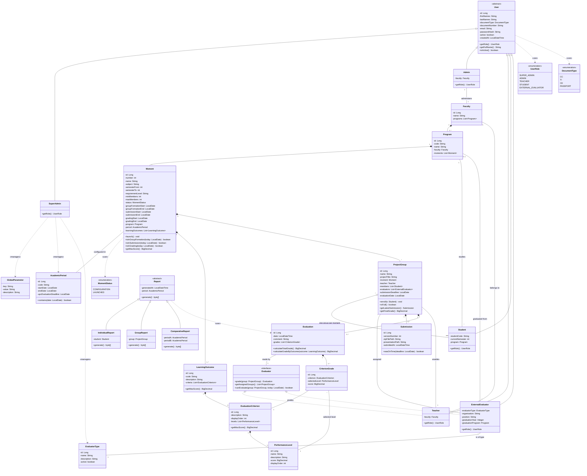

# Diagrama de clases (vigente · Etapa 1)

Modelo de dominio de SIERAP con herencia, clases abstractas, interfaces,
enumeraciones y relaciones de composición, agregación, asociación y dependencia.
GitHub renderiza este diagrama directamente a partir del código Mermaid.

> **Este es el diagrama vigente** y el contrato de la Etapa 1: incorpora las
> decisiones del 2026-09-24 (ver `docs/04`, sección "Decisiones del equipo", y los
> ADR-009 a ADR-014). Clases y atributos en inglés (ADR-014). La versión con diseño detallado
> ([`diagrama_clases_mejorado.png`](diagrama_clases_mejorado.png) · editable en
> [`diagrama_clases_mejorado.drawio`](diagrama_clases_mejorado.drawio)) corresponde
> a la Fase 2 y se regenera al cerrar la Etapa 1. El diagrama preliminar de la
> Fase 1 sigue en [`diagrama_clases.drawio`](diagrama_clases.drawio).

## Cambios de la Etapa 1 (decisiones del 2026-09-24)

| Cambio | Motivo |
|---|---|
| Todas las clases, atributos y métodos pasan a inglés (`Facultad` → `Faculty`, `Momento` → `Moment`, `RAP` → `LearningOutcome`, `CriterioEvaluacion` → `EvaluationCriterion`, `NivelDesempeno` → `PerformanceLevel`, `Grupo` → `ProjectGroup`…); la tabla de equivalencias está en `docs/03` | El código se escribe en inglés y solo lo que ve el usuario final queda en español (ADR-014). |
| Puntajes (`score`, `getMaxScore()`, notas) como `BigDecimal` en lugar de `double` | Sumas exactas: el Momento 1 debe dar 5.00, no 4.9999… (ADR-013). |
| `Usuario`: `nombre` → `nombres` + `apellidos`; nuevos `tipoDocumento` y `numeroDocumento`; enum `TipoDocumento` | Guardar el documento de identidad además del correo, que es el dato de inicio de sesión. |
| `Empresario` y `Egresado` → una sola subclase `EvaluadorExterno` con `TipoEvaluador` (catálogo) | Se deben poder crear más tipos de evaluador sin programar (ADR-011). |
| `Docente` pertenece a una `Facultad` | Solo usan SIERAP los docentes con proyecto de aula, que dictan en su facultad. |
| `Estudiante` pierde `grupo` y gana `programa` | Un estudiante tiene un grupo por momento con historial; la relación queda del lado de `Grupo`. |
| `Momento` pertenece a un `PeriodoAcademico`; `nivelExigencia` pasa a texto libre | La configuración se versiona por periodo y no hay niveles estándar (ADR-010). |
| `Momento` gana `estado` (`EstadoMomento`), integrantes mín./máx. y tres ventanas de fechas | Ciclo de vida del momento: configuración → lanzar → entregas → calificación (ADR-012). |
| `RAP` pertenece a un `Momento` (composición) y pierde `pesoEvaluativo` | Cada momento tiene sus propios RAP; el peso lo dan los puntajes de sus criterios. |
| Nuevas `CriterioEvaluacion` y `NivelDesempeno` (entidad) | Estructura de la rúbrica de la UPC: cada RAP tiene criterios y cada criterio niveles con puntaje, todo configurable. |
| `Grupo` y `ProyectoAula` se fusionan; `Grupo` pertenece a un `Momento` | Cada grupo tiene un solo proyecto; el docente habilita grupos dentro de un momento. |
| `CalificacionRAP` → `CalificacionCriterio` | El evaluador elige un nivel por criterio; el desempeño por RAP se calcula sumando. |
| Se eliminan los enums `NivelExigencia` y `NivelDesempeno` | Nada estándar en el código (ADR-010). |
| Sin autoevaluación del estudiante | `Estudiante` no implementa `Evaluador`. |

## Cambios frente al diagrama preliminar (Fase 1)

| Cambio | Motivo |
|---|---|
| `PeriodoAcademico` (nueva) | RF 9 exige validar que la fecha de evaluación caiga en el rango de la UPC, y RF 12 compara resultados entre semestres y años: ambos necesitan el periodo como entidad. |
| `ParametroGlobal` (nueva) | RF 11: el super_admin define parámetros globales (p. ej. integrantes por grupo) sin hardcodearlos. |
| `Reporte` pasa a ser abstracta con 3 subclases | Cada tipo de reporte implementa su propio `generar()`: polimorfismo en lugar de un `switch` por tipo. Resuelve el pendiente de la Fase 1 sobre reportería. |
| `Usuario.getRol()` abstracto | Cada rol lo sobrescribe; `iniciarSesion()` sale del dominio y pasa a `AuthService` (capa de servicio). |
| Multiplicidad `3..5` en `Grupo`—`Estudiante` | Confirma la cardinalidad de la guía oficial que estaba pendiente. |
