# Entity-relationship diagram (database)

Physical model of the SIERAP PostgreSQL database: the 26 tables created by the Flyway
migrations in `backend/src/main/resources/db/migration/` (V1 to V9), with their columns,
types, keys and relationships. GitHub renders this diagram directly from the Mermaid
code. Flyway's own `flyway_schema_history` table is left out.

The class diagram ([`diagrama_clases.md`](diagrama_clases.md)) shows the same model from
the Java side. When a new migration changes a table, update this diagram in the same PR.
Test data for this schema is in [`../database/test-data.sql`](../database/test-data.sql)
and the constraint demonstrations are in
[`../database/rejection-tests.sql`](../database/rejection-tests.sql).

**Notation.** `PK` primary key, `FK` foreign key, `UK` unique. `||--o{` reads "one to
zero or many" and `||--o|` "one to zero or one" (role tables of the JOINED inheritance,
ADR-009). Grades and weights are `numeric(5,2)`, never floating point (ADR-013).

```mermaid
erDiagram
    %% ============ Academic structure (V1, V5, V9) ============
    faculty {
        bigint id PK
        varchar(20) code UK
        varchar(150) name
    }
    program {
        bigint id PK
        varchar(20) code UK
        varchar(150) name
        bigint faculty_id FK
    }
    academic_period {
        bigint id PK
        varchar(20) code UK
        date start_date
        date end_date
        date upc_evaluation_deadline
    }
    global_parameter {
        bigint id PK
        varchar(100) param_key UK
        varchar(500) param_value
        varchar(500) description
    }
    moment {
        bigint id PK
        bigint program_id FK "UK with period_id and number"
        bigint period_id FK
        integer number
        varchar(100) name
        varchar(150) subject
        integer semester_from
        integer semester_to
        varchar(100) requirement_level
        integer min_members
        integer max_members
        varchar(20) status "CONFIGURATION or LAUNCHED"
        date group_formation_start
        date group_formation_end
        date submission_start
        date submission_end
        date grading_start
        date grading_end
        numeric teacher_weight "5,2 - percent"
    }
    learning_outcome {
        bigint id PK
        bigint moment_id FK "UK with code"
        varchar(20) code
        varchar(1000) description
    }
    evaluation_criterion {
        bigint id PK
        bigint learning_outcome_id FK
        varchar(500) description
        integer display_order
    }
    performance_level {
        bigint id PK
        bigint criterion_id FK
        varchar(50) name
        varchar(1000) description
        numeric score "5,2"
        integer display_order
    }
    evaluator_weight {
        bigint id PK
        bigint moment_id FK "UK with evaluator_type_id"
        bigint evaluator_type_id FK
        numeric weight "5,2 - percent"
    }

    %% ============ Users and roles (V3, V6) ============
    evaluator_type {
        bigint id PK
        varchar(100) name UK
        varchar(500) description
        boolean active
    }
    app_user {
        bigint id PK
        varchar(30) role "SUPER_ADMIN, ADMIN, TEACHER, STUDENT, EXTERNAL_EVALUATOR"
        varchar(100) first_names
        varchar(100) last_names
        varchar(20) document_type "CC, TI, CE, PASSPORT"
        varchar(30) document_number UK
        varchar(150) email UK "lowercase"
        varchar(100) password_hash "BCrypt, null until activated"
        boolean active
        timestamp created_at
        boolean must_change_password
        bigint created_by_id FK
    }
    super_admin {
        bigint id PK, FK
    }
    admin {
        bigint id PK, FK
        bigint faculty_id FK
    }
    teacher {
        bigint id PK, FK
        bigint faculty_id FK
    }
    student {
        bigint id PK, FK
        varchar(30) student_code UK
        integer current_semester
        bigint program_id FK
        bigint registration_code_id FK
    }
    external_evaluator {
        bigint id PK, FK
        bigint evaluator_type_id FK
        varchar(150) organization
        varchar(100) job_position
        integer graduation_year
        bigint graduation_program_id FK
    }

    %% ============ Authentication (V6) ============
    registration_code {
        bigint id PK
        varchar(20) code UK
        bigint teacher_id FK
        bigint program_id FK
        date expires_on
        boolean active
        timestamp created_at
    }
    refresh_token {
        bigint id PK
        bigint user_id FK
        varchar(64) token_hash UK "SHA-256"
        timestamp expires_at
        timestamp rotated_at
        timestamp created_at
    }
    password_token {
        bigint id PK
        bigint user_id FK
        varchar(64) token_hash UK "SHA-256"
        varchar(20) purpose "ACCOUNT_SETUP or PASSWORD_RESET"
        timestamp expires_at
        timestamp used_at
        timestamp created_at
    }

    %% ============ Moment operation (V4, V8) ============
    project_group {
        bigint id PK
        bigint moment_id FK "UK with teacher_id and name"
        bigint teacher_id FK
        varchar(100) name
        varchar(200) project_title
        date submission_deadline
        date evaluation_date
    }
    project_group_member {
        bigint project_group_id PK, FK
        bigint student_id PK, FK
    }
    project_group_evaluator {
        bigint project_group_id PK, FK
        bigint external_evaluator_id PK, FK
    }
    submission {
        bigint id PK
        bigint project_group_id FK "UK with version_number"
        integer version_number
        varchar(500) zip_file_path
        varchar(500) presentation_path
        timestamp submitted_at
        boolean late
        varchar(255) zip_file_name
        bigint zip_size
        varchar(255) presentation_file_name
        bigint presentation_size
    }

    %% ============ Grading (V4, V7) ============
    evaluation {
        bigint id PK
        bigint project_group_id FK "UK with evaluator_id"
        bigint evaluator_id FK "teacher or external evaluator"
        varchar(20) status "DRAFT or SUBMITTED"
        timestamp evaluated_at
        varchar(2000) comment
    }
    criterion_grade {
        bigint id PK
        bigint evaluation_id FK "UK with criterion_id"
        bigint criterion_id FK
        bigint performance_level_id FK
        numeric score "5,2 - copy of the level score"
    }
    individual_grade {
        bigint id PK
        bigint evaluation_id FK "UK with student_id and criterion_id"
        bigint student_id FK
        bigint criterion_id FK
        bigint performance_level_id FK
        numeric score "5,2 - copy of the level score"
    }

    %% ============ Relationships ============
    faculty ||--o{ program : offers
    faculty ||--o{ admin : "administered by"
    faculty ||--o{ teacher : employs
    program ||--o{ moment : has
    academic_period ||--o{ moment : schedules
    moment ||--o{ learning_outcome : evaluates
    learning_outcome ||--o{ evaluation_criterion : "measured by"
    evaluation_criterion ||--o{ performance_level : "graded with"
    moment ||--o{ evaluator_weight : weighs
    evaluator_type ||--o{ evaluator_weight : "weighted in"

    app_user ||--o| super_admin : "is a"
    app_user ||--o| admin : "is a"
    app_user ||--o| teacher : "is a"
    app_user ||--o| student : "is a"
    app_user ||--o| external_evaluator : "is a"
    app_user |o--o{ app_user : creates
    program ||--o{ student : enrolls
    evaluator_type ||--o{ external_evaluator : classifies
    program |o--o{ external_evaluator : "graduated from"

    teacher ||--o{ registration_code : shares
    program ||--o{ registration_code : "registers into"
    registration_code |o--o{ student : "used by"
    app_user ||--o{ refresh_token : "signed in with"
    app_user ||--o{ password_token : receives

    moment ||--o{ project_group : contains
    teacher ||--o{ project_group : enables
    project_group ||--o{ project_group_member : has
    student ||--o{ project_group_member : "belongs to"
    project_group ||--o{ project_group_evaluator : has
    external_evaluator ||--o{ project_group_evaluator : "assigned to"
    project_group ||--o{ submission : uploads

    project_group ||--o{ evaluation : "graded in"
    app_user ||--o{ evaluation : grades
    evaluation ||--o{ criterion_grade : contains
    evaluation_criterion ||--o{ criterion_grade : "graded in"
    performance_level ||--o{ criterion_grade : "chosen in"
    evaluation ||--o{ individual_grade : adjusts
    student ||--o{ individual_grade : receives
    evaluation_criterion ||--o{ individual_grade : "adjusted in"
    performance_level ||--o{ individual_grade : "chosen in"
```

## Referential actions (ADR-016)

| Action | Foreign keys | Reason |
|---|---|---|
| `ON DELETE CASCADE` | program → faculty; moment → program; learning_outcome → moment; evaluation_criterion → learning_outcome; performance_level → evaluation_criterion; evaluator_weight → moment; role tables → app_user; refresh_token, password_token → app_user; project_group_member, project_group_evaluator, submission, evaluation → project_group; criterion_grade, individual_grade → evaluation | Composition: the part does not exist without the whole |
| No action (`RESTRICT`) | project_group → moment and teacher; evaluation → app_user; criterion_grade and individual_grade → criterion and level; student → program; admin and teacher → faculty; external_evaluator → evaluator_type; registration_code → teacher and program; evaluator_weight → evaluator_type | Academic history: a moment, user, criterion or level that already has groups or grades cannot be deleted |
| `ON DELETE SET NULL` | app_user.created_by_id → app_user | The account survives; only who created it is lost |
