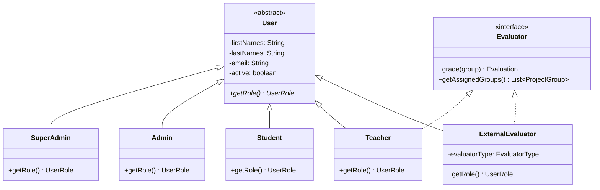
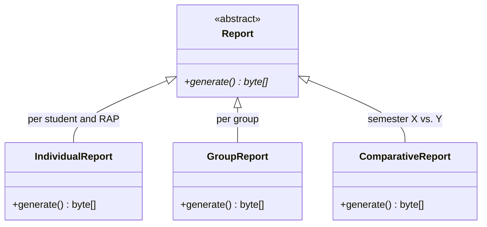
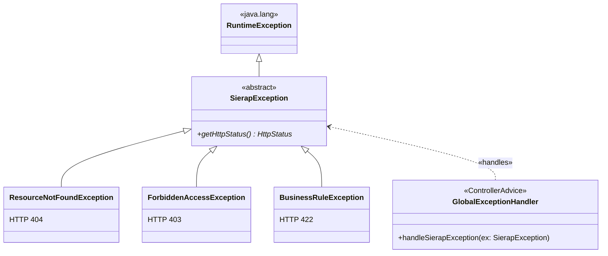
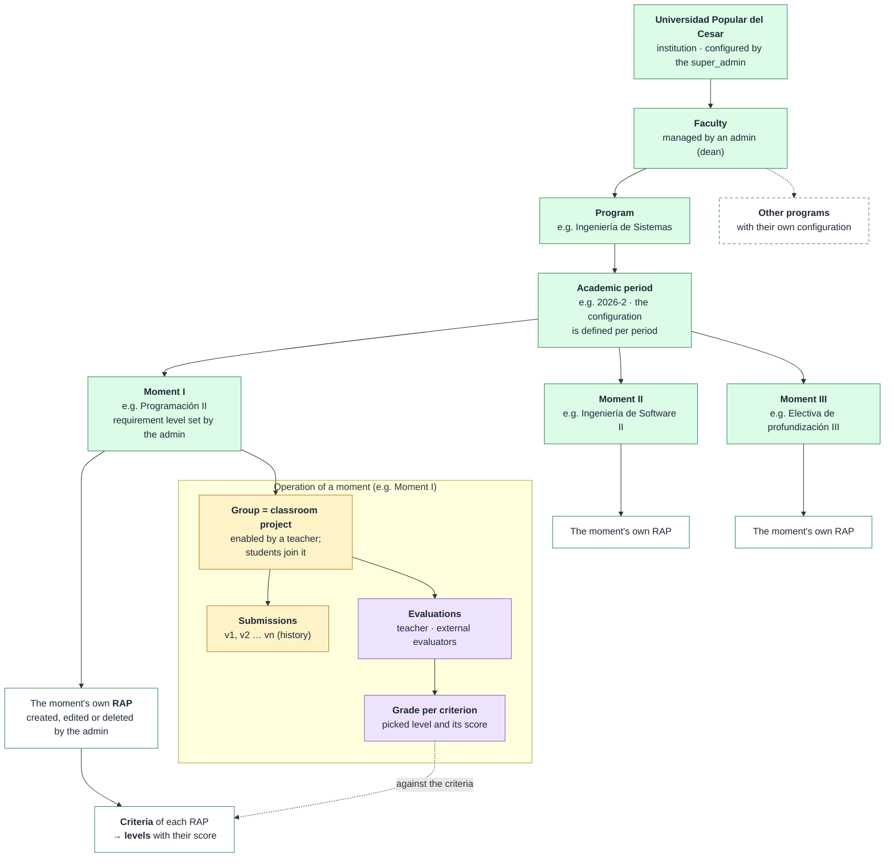
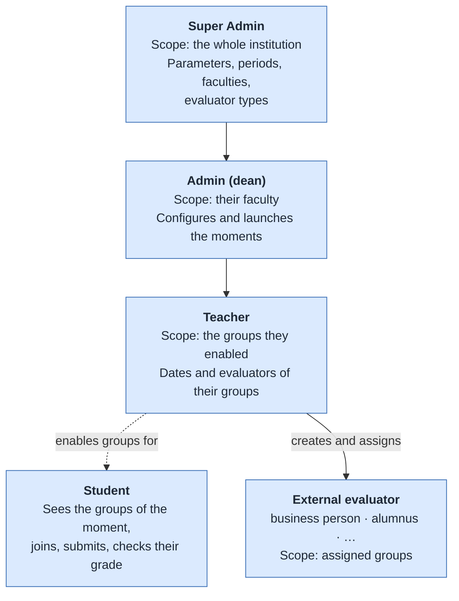
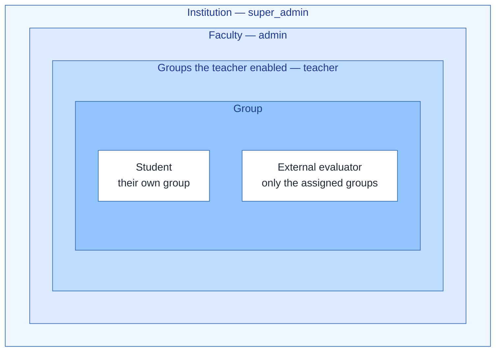

# Hierarchy diagram

Four hierarchies that structure SIERAP. GitHub renders each block directly from the
Mermaid code.

> Detailed-design version (the four panels on a single sheet, still with the Spanish
> names from before ADR-014): [`diagrama_jerarquias.png`](diagrama_jerarquias.png) ·
> editable in [`diagrama_jerarquias.drawio`](diagrama_jerarquias.drawio).

## 1. Inheritance hierarchy — Users

Abstraction + inheritance + interface: the basis of the project's OOP.

- `User` is abstract: there is no "generic user", only the five concrete roles.
- `getRole()` is polymorphic: each subclass overrides it and Spring Security decides permissions with that value.
- `Teacher` and `ExternalEvaluator` grade groups, but they do not share a parent of
  their own for that: the common behavior is expressed with the `Evaluator` interface.
- Business person, alumnus and the types created later are not classes: they are values
  of the `EvaluatorType` catalog of an `ExternalEvaluator` (ADR-011).
- `Student`, `Admin` and `SuperAdmin` do not grade, so they do not implement `Evaluator`.
- In JPA the inheritance is mapped with `@Inheritance(JOINED)`: an `app_user` table + one table per role (ADR-009).

## 2. Inheritance hierarchies — Reports and exceptions

Polymorphism in reporting and centralized error handling with `@ControllerAdvice`.

## 3. Institutional and academic hierarchy

Configuration (super_admin / admin) → operation of each moment (teacher, students, evaluators).

Each moment has its own RAP, criteria and levels with scores, defined by the admin in
each academic period; nothing is fixed in the code (ADR-010). The grade of an
evaluation is the sum of the scores of the levels picked in each criterion.

## 4. Role hierarchy and access scope

Each level sees only a subset of what the level above sees. Filtering is applied in the
service layer, not in the user interface.

