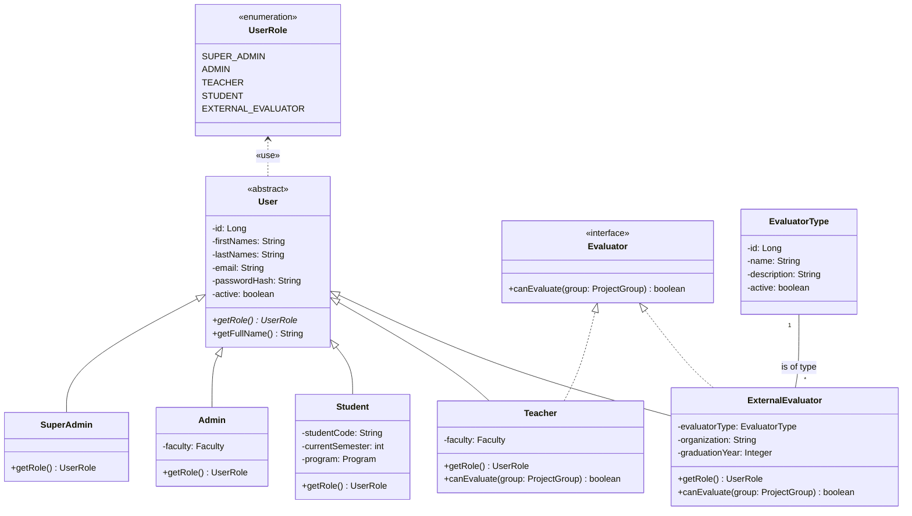
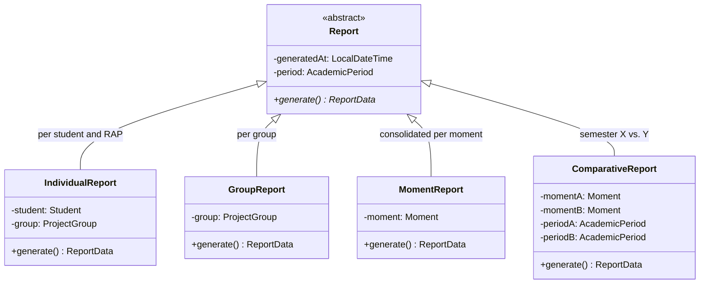
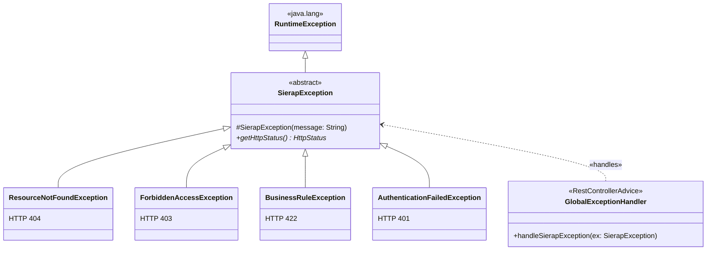
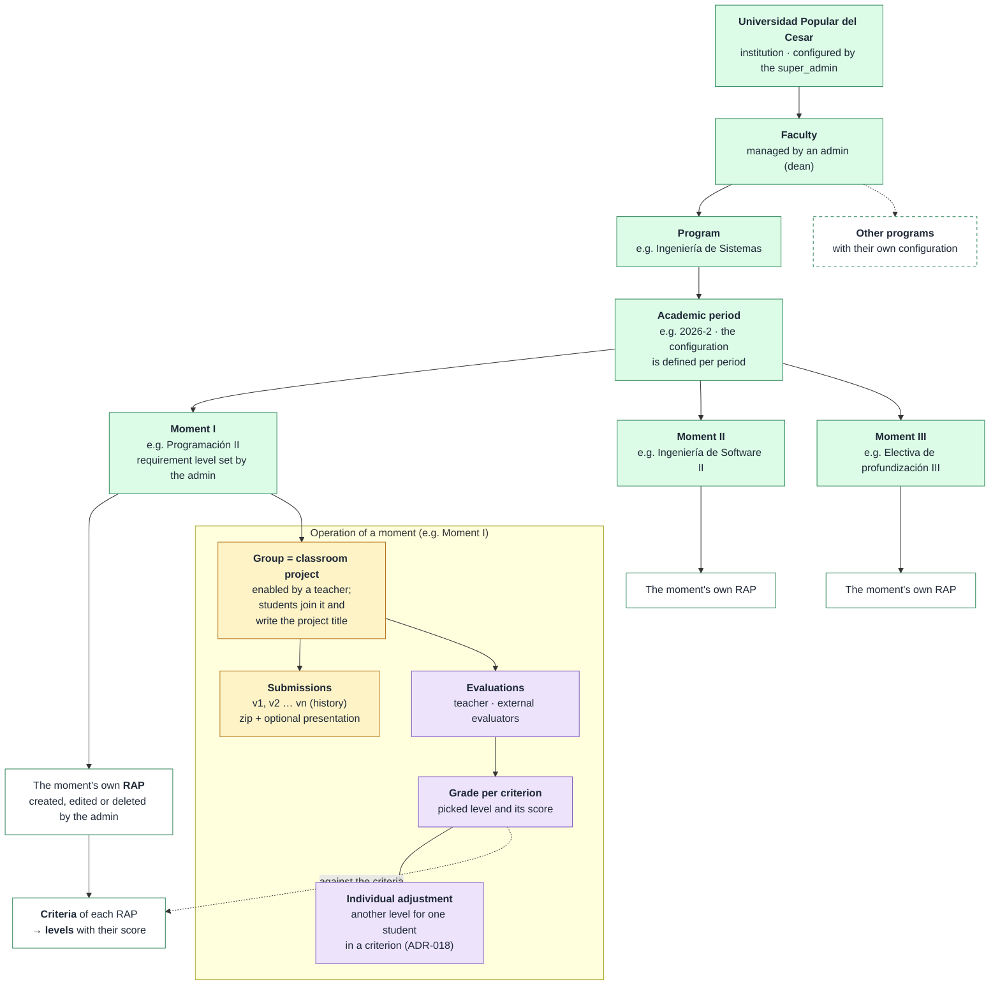
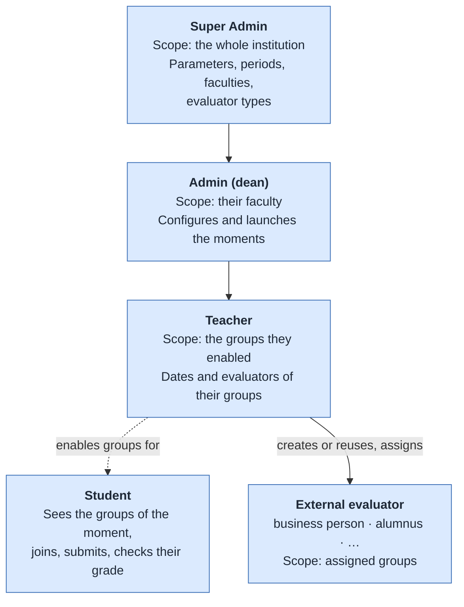
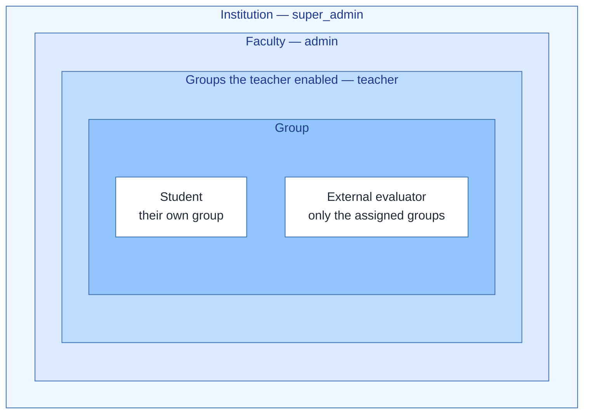

# Hierarchy diagram

Four hierarchies that structure SIERAP. GitHub renders each block directly from the
Mermaid code.

> Detailed-design version, with the same four hierarchies on one sheet:
> [`diagrama_jerarquias.png`](diagrama_jerarquias.png) (also
> [SVG](diagrama_jerarquias.svg); editable in
> [`diagrama_jerarquias.drawio`](diagrama_jerarquias.drawio)), regenerated in English
> when Stage 1 closed. When a hierarchy changes, update this Mermaid code and the
> `.drawio` together.

## 1. Inheritance hierarchy — Users

Abstraction + inheritance + interface: the basis of the project's OOP.

- `User` is abstract: there is no "generic user", only the five concrete roles.
- `getRole()` is polymorphic: each subclass overrides it and Spring Security decides permissions with that value.
- `Teacher` and `ExternalEvaluator` grade groups, but they do not share a parent of
  their own for that: the common behavior is expressed with the `Evaluator` interface,
  and each one implements its own `canEvaluate()` rule (the teacher who enabled the
  group, the external evaluators assigned to it). Dates are not part of the interface:
  the service checks the grading window with the injected `Clock`.
- Business person, alumnus and the types created later are not classes: they are values
  of the `EvaluatorType` catalog of an `ExternalEvaluator` (ADR-011).
- `Student`, `Admin` and `SuperAdmin` do not grade, so they do not implement `Evaluator`.
- In JPA the inheritance is mapped with `@Inheritance(JOINED)`: an `app_user` table + one table per role (ADR-009).

## 2. Inheritance hierarchies — Reports and exceptions

Polymorphism in reporting and centralized error handling with `@RestControllerAdvice`.
The reports are designed but not built yet (Stage 7).

Each subclass returns its own HTTP status from `getHttpStatus()`, and
`GlobalExceptionHandler` answers with the same `ErrorResponse` for all of them.

## 3. Institutional and academic hierarchy

Configuration (super_admin / admin) → operation of each moment (teacher, students, evaluators).

Each moment has its own RAP, criteria and levels with scores, defined by the admin in
each academic period; nothing is fixed in the code (ADR-010). The grade of an
evaluation is the sum of the scores of the levels picked in each criterion, and the
final grade is a weighted average by kind of evaluator (the teacher and each
`EvaluatorType`), with the weights the admin sets in each moment. The group is graded
once and every member inherits its levels; an evaluator can change the level of one
student in a criterion, and that individual grade is each student's final grade
(ADR-018).

## 4. Role hierarchy and access scope

Each level sees only a subset of what the level above sees. Filtering is applied in the
service layer (`AccessScope` and the rules of each service), not in the user interface.
Students are the exception to the nesting while groups are formed: they see every group
of the moment of their semester to join one, and then only their own group.

