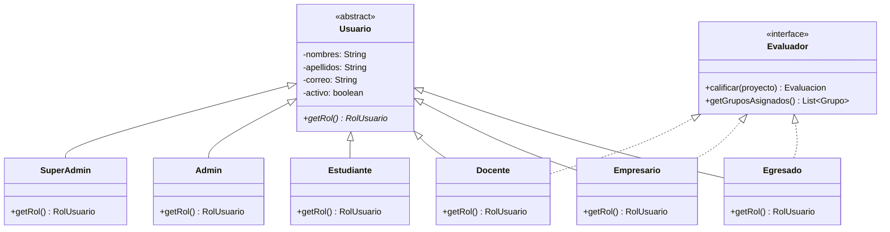
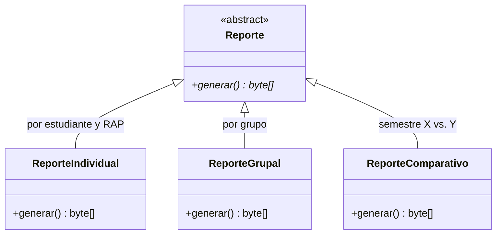
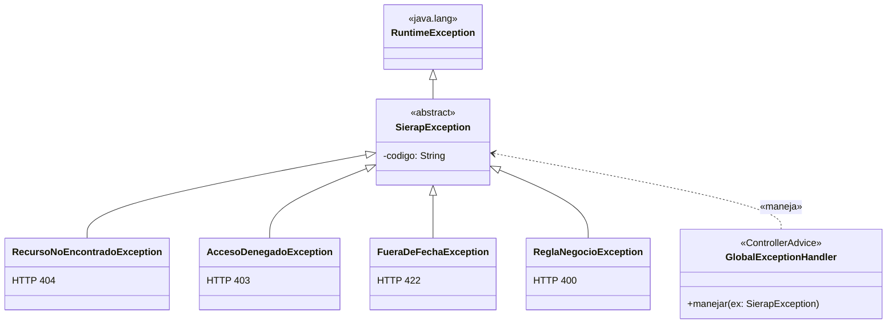
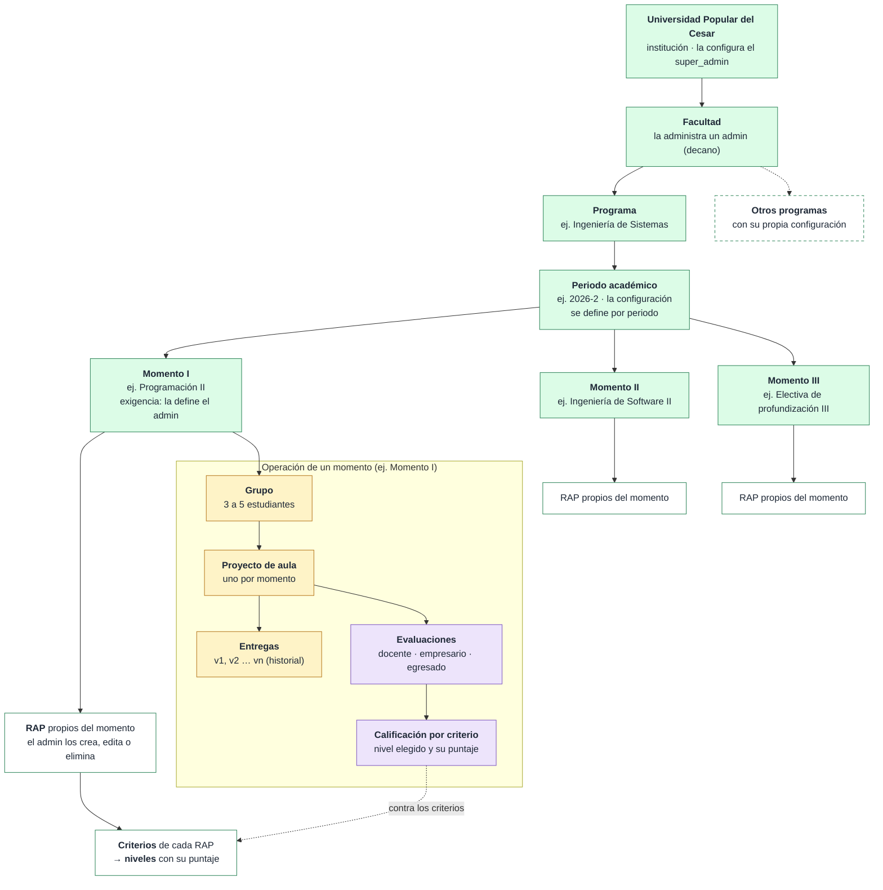
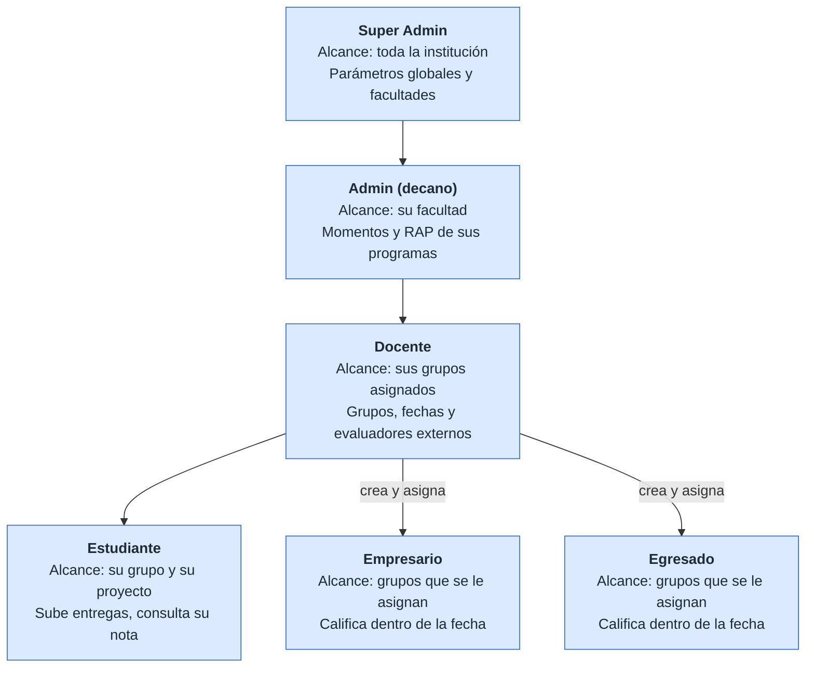
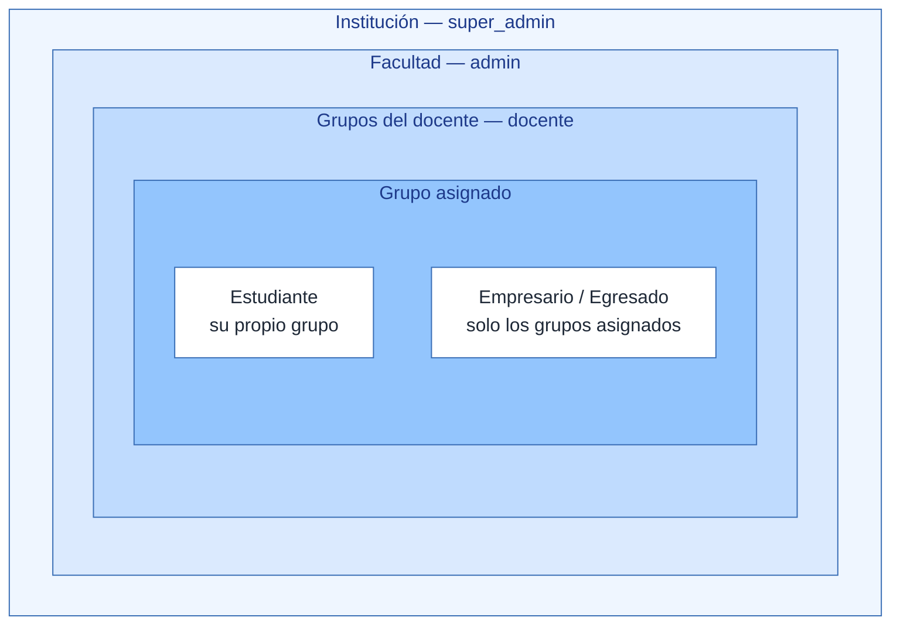

# Diagrama de jerarquías

Cuatro jerarquías que estructuran SIERAP. GitHub renderiza cada bloque
directamente a partir del código Mermaid.

> Versión con diseño detallado (los cuatro paneles en una sola lámina):
> [`diagrama_jerarquias.png`](diagrama_jerarquias.png) · editable en
> [`diagrama_jerarquias.drawio`](diagrama_jerarquias.drawio).

## 1. Jerarquía de herencia — Usuarios

Abstracción + herencia + interfaz: la base de la POO del proyecto.

- `Usuario` es abstracta: no existe un "usuario genérico", solo los seis roles concretos.
- `getRol()` es polimórfico: cada subclase lo sobrescribe y Spring Security decide los permisos con ese valor.
- Docente, Empresario y Egresado califican proyectos, pero no comparten un padre propio
  para eso: el comportamiento común se expresa con la interfaz `Evaluador`.
- Estudiante, Admin y SuperAdmin no evalúan, por eso no implementan `Evaluador`.
- En JPA la herencia se mapea con `@Inheritance` (estrategia a decidir en un ADR de la Etapa 1).

## 2. Jerarquías de herencia — Reportes y excepciones

Polimorfismo en la reportería y manejo centralizado de errores con `@ControllerAdvice`.

## 3. Jerarquía institucional y académica

Configuración (super_admin / admin) → operación de cada momento (docente, estudiantes, evaluadores).

Cada momento tiene sus propios RAP, criterios y niveles con puntaje, definidos por el
admin en cada periodo académico; nada viene fijo en el código (ADR-010). La nota de una
evaluación es la suma de los puntajes de los niveles elegidos en cada criterio.

## 4. Jerarquía de roles y alcance de acceso

Cada nivel ve solo un subconjunto de lo que ve el nivel superior. El filtrado se aplica
en la capa de servicio, no en la interfaz.

